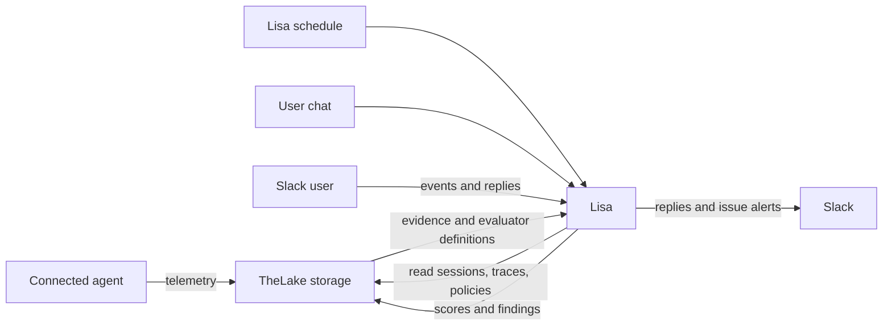

# Lisa: the proactive agent QA engineer

## Ownership contract

Lisa owns proactive QA work. TheLake is the telemetry and findings store Lisa
uses. TheLake ingests agent telemetry, stores evaluator definitions, sessions,
traces, scores, and findings, and serves bounded workspace-scoped queries. It
does not decide when Lisa works, run Lisa's investigations, or call Lisa when
new data arrives.

Lisa owns the schedule and evaluation loop. On each scheduled cycle, she
selects eligible sessions from TheLake, reads the relevant trace and policy
evidence, applies confirmed rules, investigates suspected problems, and writes
evaluation results or findings back to TheLake. Lisa sends any Slack
notification herself. Lisa's schedule or a user message starts Lisa work;
TheLake never starts it:



Trace arrival makes evidence available; it does not trigger TheLake to invoke
Lisa. A chat client connects directly to Lisa for user-initiated conversations.
TheLake provides storage APIs only; it is not Lisa's scheduler, agent runtime,
or event dispatcher. Evaluation execution and retry policy belong to Lisa's
runtime. TheLake stores the resulting scores and findings.

## Lisa runtime

Lisa runs as a workspace-scoped conversation runtime. The OpenHands adapter
loads standard AgentSkills through its SDK `AgentContext` and connects a
FastMCP tool package through OpenHands `mcp_config`; no Lisa-only OpenHands
`ToolDefinition` actions are embedded in the agent. The tool package does not
import OpenHands and can be launched by another backend with the same trusted
workspace scope. Deploy one Lisa runtime for each workspace. Each runtime is
configured with that workspace's signed TheLake scope and stores Lisa's
conversations and policy files under a workspace-isolated home. The runtime
may start for scheduled work or a user conversation and stop when idle. Lisa
does not require access to the agent's source repository to evaluate captured
behavior. The local Compose setup runs one workspace; a multi-workspace
deployment runs one scoped Lisa runtime per workspace.

Lisa can read workspace and agent `POLICY.md` files, search bounded session
evidence, and manage named evaluations through MCP tools. Each policy is a
human-readable heading and Markdown text; IDs and evaluation metadata are
internal. Lisa proposes policy changes in chat and writes them only after the
owner explicitly confirms the exact policy name. A new evaluation remains a
draft until the owner activates it in Explorer or explicitly asks Lisa to
activate it in chat. During scheduled QA Lisa applies active evaluations and
reports uncovered policies, but never creates or activates them. The
`learn-agent-policy`, `review-agent-policy`, `manage-behavior-checks`, and
`investigate-evaluator-failure` skills define these workflows. Explorer shows
the resulting checks and review controls.

Lisa owns recurring QA work. On each scheduled cycle she reviews policy memory
and recent sessions even when no evaluation exists, prioritizes evidence-backed
risks, applies active evaluations, and reports new policy coverage gaps without
repeating unchanged requests every cycle. She proposes emerging expectations
in her report rather than
treating traces as proof of policy or saving unapproved rules. Lisa investigates
failures and sends configured Slack notifications. A user can also start a
direct conversation with Lisa; automatic QA does not depend on a user prompt or
a Slack installation.

## Product promise

Every workspace has a persistent Softprobe agent named Lisa: an AI QA engineer
for the business and its production agents. Lisa learns how the business is
supposed to work, applies that knowledge to real agent sessions, and takes
responsibility for finding and explaining behavior problems. Customers should
not need to write evaluator code, label every failure first, or operate a
separate evaluation platform to get value.

The outcome is an actionable answer to: **Which agent behavior is putting a
customer, business outcome, or policy at risk; what evidence shows it; and what
should we do next?** Traces are evidence Lisa uses, not the product outcome by
themselves.

## Lisa's operating model

Lisa is one continuing agent identity per workspace, with an isolated VM
runner and a durable home directory. The runner gives Lisa a place to work
with approved tools and retain simple, inspectable notes. It can be started
when Lisa has work and stopped when idle; her identity, approved memory, and
conversation persist independently of a live VM process. She is not a separate
agent instance for every trace. Evaluation work can be parallel and bounded,
while Lisa owns the workspace-level context, follow-up, and conversation.

The workspace boundary applies to Lisa's conversation, files and memory,
credentials, source access, telemetry, evaluator configuration, and findings.
Lisa receives only the data and capabilities the workspace has authorized.
The specific VM provider and agent runtime are implementation choices; the
workspace-scoped identity, isolation, durable home, and tool boundary are the
product contract.

```text
Approved business sources ─┐
Agent definitions/tools ────┼─> Lisa's workspace knowledge ──┐
Production sessions ────────┘                                │
                                                             v
New session ─> TheLake stores evidence <── Lisa's scheduled sampling and checks
                     ^                         │
                     └── Lisa stores findings ─┘
                               │
                               v
                   Lisa follows up in chat and
                   tracks issue resolution
```

## What Lisa learns

Lisa builds a practical model of the business from three evidence classes:

1. **Authoritative sources:** approved policy pages, support procedures,
   product documentation, and other sources the workspace connects or provides.
2. **Agent behavior and capabilities:** agent identity, prompts or instructions
   when explicitly made available, tool descriptions, and the order and results
   of tool calls in captured sessions.
3. **Operational evidence:** repeated session patterns, successful outcomes,
   failures, user feedback, and confirmed corrections.

Lisa keeps the knowledge understandable and reviewable. Start with plain
Markdown policy notes in Lisa's persistent home: one workspace-wide
`POLICY.md`, plus an optional `POLICY.md` for each registered agent. Each rule
should say what must happen, when it applies, what evidence can establish it,
and where it came from. Preserve a source reference and the date or revision
used when available. Keep the source content and rule text readable without a
proprietary memory viewer.

Lisa distinguishes:

- **Confirmed rules:** grounded in an authoritative source or owner
  confirmation. These may drive actionable QA checks.
- **Candidate rules:** plausible interpretations or emerging patterns that
  need confirmation. Lisa can ask about or present these, but must not alert as
  though they were established policy.
- **Observed behavior:** what agents have done, without claiming that it is
  required or correct.

An observed trace alone does not prove a business rule. A repeated behavior can
help Lisa notice a pattern and ask a useful question, but it does not silently
become policy. When sources conflict, Lisa records the conflict and seeks
resolution rather than choosing a rule without evidence. In the product, an
owner must confirm a rule before it becomes eligible to alert, and the
resulting evaluator must be explicitly activated. A model-generated status or
source citation alone is not approval.

Plain files are the initial memory interface, not a commitment to build a
general-purpose memory platform. Add a separate memory service only if concrete
needs such as concurrent writes, audit history, permissions, retrieval scale,
or cross-workspace controls cannot be met cleanly by files and existing
workspace storage.

## How Lisa finds issues

Lisa works after an agent is connected. A user does not have to first identify
a bad session or ask Lisa to evaluate it. Lisa's own schedule starts each
evaluation decision; trace arrival only makes evidence available in TheLake.
The schedule does not imply that every trace must invoke an LLM judge.

### Trigger and sampling plan

Use three lanes as Lisa grows:

1. **Policy coverage:** run confirmed, high-impact checks on every session to
   which the policy applies. This is the dependable lane for known risks; do
   not sample away rare, consequential violations.
2. **Risk hints:** Lisa proactively prioritizes sessions with signals such as
   risky tool calls, retries, errors, escalation, negative feedback, or unusual
   cost/latency.
   Hints decide what Lisa inspects; they are not themselves proof of a defect.
3. **Discovery sampling:** periodically inspect ordinary sessions to find
   behaviors that current policies do not cover. A sampled pattern can become
   a proposed rule in the report, but traces alone cannot confirm business
   policy. Save it to `POLICY.md` only after explicit owner approval.

The first implementation registers one process-local APScheduler cron job per
workspace, named `Lisa scheduled QA`. Its five-field UTC schedule is controlled
by `LISA_QA_CRON` and defaults to `0 * * * *` (hourly at minute 0). It does not
run on startup or poll every minute. The quickstart dogfood uses
`*/5 * * * *` so the walkthrough can finish quickly. Each cron fire starts one
fresh model turn. The current skill checks the newest eligible session first;
this is a rate cap, not a random or statistically representative sample.
Durable coordination and retries belong to Lisa's runtime and remain future
work.

Lisa's cron job starts a fresh model turn on its configured schedule.
Lisa follows the `own-agent-qa` skill to inspect policy memory, recent sessions,
and active evaluations, identify useful risks, report new uncovered named
policies without asking for routine hourly approval, and review evidence. The evaluation tool sends bounded
evidence to the configured judge and stores
the verdict in TheLake; a separate Slack tool sends an alert only after Lisa
reviews a stored failure. Each scheduled turn starts with fresh model context;
the previous report is supplied as bounded context to avoid repeating an
unchanged request. Lisa stores pending failed-evaluation follow-ups in her
workspace home until they are investigated, reported, and any configured Slack
notification succeeds (or Lisa confirms no destination is configured). Slack
notification receipts make retries idempotent. Local Compose persists this
workspace home in the `lisa-data` volume, so pending follow-ups survive Lisa
container restarts. Removing that volume removes Lisa's local memory.
Lisa writes a recoverable failure record before persisting its score, then
reconciles interrupted score writes from that record on the next follow-up
check. It verifies the queued trace itself before notifying, including when a
session contains more than one trace.
Evaluation tool calls use a stable score ID and check stored scores before
calling the judge again, so the same evaluation version and trace do not pay
for repeated judgments. The schedule runs in the Lisa process; there is no
durable schedule cursor or accepted-work queue yet. If Lisa is unavailable at
a scheduled time, that run is missed. Trace arrival alone does not start a
Lisa turn. Run one scheduler process per workspace; multiple Lisa replicas
can each execute the cron job.

Sampling must not turn an unchecked trace into an apparent pass. The product
should show evaluated, pending, skipped, and failed work with the reason, plus
coverage by agent and check. A durable queue with retries and visible work
status is required before claiming continuous, lossless monitoring. High-risk
policy checks can later bypass the discovery rate cap while ordinary discovery
work remains sampled.

For each newly captured session selected by its trigger policy, the QA loop:

1. Resolves the workspace and agent, then selects the applicable confirmed
   rules and enabled checks.
2. Collects the bounded session evidence needed to assess those rules,
   including relevant tool calls, results, messages, and outcome context.
3. Runs checks through an evaluation runtime. Natural-language rubrics and
   existing evaluator frameworks are preferred over customer-authored code
   for ordinary business behavior checks.
4. Stores the verdict, rationale, evidence references, rule/evaluator version,
   and processing status so the result can be explained and reproduced.
5. Groups related failures into an issue Lisa can own, investigate, and discuss.

Lisa should report more than a score. An issue should state the affected agent
and behavior, the business rule and source, the session evidence, likely impact,
how certain the finding is, whether it is new or recurring, and a useful next
action. Where evidence is incomplete or the evaluator is uncertain, Lisa says
so and avoids presenting a guess as a confirmed defect.

“Near real time” means evaluation starts promptly after capture and produces a
finding while the session is still useful to an operator. It does not promise
synchronous evaluation in the agent's request path. Ingestion must remain
independent of a slow or unavailable judge. Before claiming continuous
monitoring, accepted evaluation work must be durably queued, idempotent, and
visible as pending, completed, or failed, with retries that cannot silently
erase QA work. An in-process best-effort trigger does not satisfy this bar.

## Human interaction

The default surface is a web chat for Lisa, backed by the same workspace
conversation and findings. A user can ask what Lisa learned, inspect or correct
a candidate rule, investigate an issue, and request a proposed fix. The web
experience should render evidence naturally: messages, tool activity, code,
diffs, and structured evaluation results.

Slack can be an optional channel for notifications and continued conversation.
The core workflow must not require a customer to be a Slack administrator or
install Slack. Chat is how people direct and understand Lisa; it is not a gate
before automatic monitoring runs.

Lisa may inspect an authorized agent repository or propose a code change only
when the workspace grants that access. The QA loop itself must work from
captured telemetry and approved business context without requiring repository
checkout or code changes.

## Product boundaries and safety

- Keep telemetry capture and storage in TheLake separate from Lisa's
  scheduling and evaluation orchestration. Lisa may delegate rubric scoring to
  a judge, but she initiates that work, interprets the evidence, and owns issue
  follow-up and user interaction.
- Treat telemetry, repository content, and retrieved documents as untrusted
  input. They cannot override system instructions or grant new permissions.
- A policy source citation and exact evaluator version must remain attached to
  a finding. Updating a policy must not rewrite the basis of a past verdict.
  Citations are author-provided context, not a verified proof of authority.
- Never treat an unapproved proposal as policy for an alert.
- Keep secrets out of Markdown memory, chat history, evaluator prompts, and
  findings. Use the workspace's credential boundary and least privilege.
- Make evaluation cost, delay, failures, and coverage visible. Do not imply
  that an unevaluated session passed.
- Sampling limits judge calls; it must not silently drop a confirmed
  high-impact check that is configured for full coverage.
- Avoid storing duplicate telemetry or introducing a second trace pipeline;
  evaluate from the workspace's captured session evidence.

## Delivery sequence

The product direction is the complete ownership loop. Delivery can be staged
without weakening that goal:

1. **Connect and observe:** connect a supported agent using the Softprobe SDK
   or auto-instrumentation; identify sessions and agents reliably.
2. **Give Lisa a home:** run one isolated, persistent Lisa runner per
   workspace when needed; provide the approved tools and simple Markdown
   memory files in durable workspace storage.
3. **Learn with provenance:** gather authorized sources and session patterns;
   propose named rules, explain their evidence, and wait for owner confirmation
   before saving them.
4. **Check sessions automatically:** apply confirmed rules to new sessions
   using natural-language evaluators and a reliable job path; create
   evidence-backed findings without a user-supplied incident.
5. **Own and resolve issues:** group recurrence, investigate with authorized
   context, converse in web chat (and optionally Slack), and propose
   remediation with human approval for consequential changes.

Each step must show user value on its own, but the success criterion is not
“rules were authored” or “traces were scored.” It is that Lisa catches a real,
meaningful agent behavior problem, explains it with evidence, and helps the
team resolve it.

## Runtime contract

Lisa has a model-backed conversation runtime, workspace and agent `POLICY.md`
memory, tools for bounded session search, evaluator execution, result storage,
and inactive evaluator drafts, plus AgentSkills for learning, reviewing, and
investigating. The tools are a local stdio MCP package independent of any
agent SDK. OpenHands is one backend adapter; additional backends reuse the
same skills and tools.

### Agent tool and skill contract

- Skills live in `skills/<skill-name>/SKILL.md` using the standard AgentSkills
  directory and frontmatter format. Keep workflow instructions portable; do
  not put tool implementations or backend-specific APIs in a skill.
- Workspace capabilities live in `lisa-agent/src/thelake_lisa/mcp_tools.py`
  as ordinary MCP tools. Tools expose bounded actions such as searching
  sessions, listing checks, evaluating one session, saving policy, and sending
  a verified failure alert. The agent backend starts this local stdio tool
  package; operators do not deploy or manage a second MCP service. Tool code
  owns workspace scoping, validation, redaction, and product API calls; Lisa
  decides which actions to take and explains what they found.
- `lisa-agent/src/thelake_lisa/runtime.py` defines the common turn result and
  backend interface. Each backend adapter translates that runtime's session,
  skill-loading, and MCP configuration into the shared contract. Add a new
  SDK dependency to that backend's optional extra, not to the shared tool
  package or API layer.
- The model receives no workspace ID tool argument. The adapter binds the
  authenticated workspace to tool execution. Policy confirmation is passed
  from the authenticated chat boundary for one turn; it is never a
  model-controlled tool parameter.

This keeps Lisa's capabilities and workflows stable as backends change. A new
adapter should reuse the existing tools and skill directory and return the
same messages and activities shape; it should not create a parallel copy of
policy, telemetry, or evaluator logic.

Explorer is Lisa's web chat and work view. It shows policy memory, evaluation
definitions, scores, findings, and investigation conversations. Slack is an
optional notification and conversation channel owned by Lisa. Evaluator
targeting uses names from telemetry until a first-class agent registry is
needed. Lisa may inspect Git repositories or run code only when the workspace
grants that access; those capabilities are not required for telemetry-based
QA.

Creating, changing, or removing a named policy requires the owner to send a
standalone chat message in the form `Confirm policy rule: <exact heading>`.
The confirmation is parsed at the authenticated chat boundary and supplied to
the MCP tool for that turn; the model cannot approve by setting a tool
argument. An evaluation draft uses the exact text of the named rule as its
rubric and requires a separate owner command naming both rule and target agent:
`Create evaluation: <exact policy name> for agent: <exact agent name>`. Activating
an evaluation in chat requires `Activate evaluation: <exact policy name> for
agent: <exact agent name>`. Evaluations retain their own source snapshot, so
editing policy memory does not alter a saved rubric. Rules have human-readable
names; storage identifiers stay internal. When a named rule exists in both
policy files, the agent-specific rule supplies the rubric for that agent.

Related implementation details: [Runtime architecture](overview.md),
[Policy memory guide](../how-to/policy-memory.md), and
[Policy dogfood workflow](../how-to/policy-dogfood.md).
